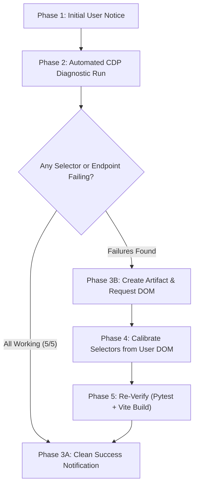

# AgentWatch V2 — Diagnostic & Endpoint Audit Skill (`Update.md`)

When a user asks you to **"update"**, **"run an update"**, **"sync with IDE"**, **"audit endpoints"**, or reports that a UI action (model switcher, task killer, queue sender, or approval button) is unresponsive, **you MUST follow this strict step-by-step procedure**.

---

## 🧭 Step-by-Step Execution Protocol (Order of Operations)

Follow these phases sequentially:



---

### Phase 1: Notify the User That the Audit Has Started

Immediately print a concise, reassuring message in the chat before executing the checks:

> 🔍 **Starting AgentWatch V2 IDE Calibration & Endpoint Audit...**  
> Checking CDP connection on port `9000` and testing 5 interaction subsystems (Model/Quota, Effort Tiers, Queue, Tasks, and Dialogs).

---

### Phase 2: Run the Automated Diagnostic Suite

Execute this non-destructive diagnostic runner script:

```python
import asyncio, httpx, json, websockets
from integrations.antigravity.adapter import antigravity_adapter

async def run_diagnostic():
    report = {"cdp": False, "subsystems": {}}
    antigravity_adapter.discover_cdp()
    chat_url = antigravity_adapter.active_chat_url
    if not chat_url:
        report["error"] = "Antigravity CDP not detected on port 9000"
        return report
    
    report["cdp"] = True
    report["target"] = chat_url

    from integrations.antigravity.cdp_actions import (
        dispatch_read_model,
        dispatch_scan_available_models,
        dispatch_get_terminal_tasks
    )

    # 1. Model & Quota
    m = await dispatch_read_model(chat_url)
    report["subsystems"]["model_and_quota"] = {
        "ok": bool(m.get("model")),
        "model": m.get("model"),
        "quota": m.get("quota_status")
    }

    # 2. Effort Tiers (Low/Medium/High)
    models = await dispatch_scan_available_models(chat_url)
    has_tiers = any("low" in (x.get("name") or "").lower() for x in models)
    report["subsystems"]["effort_tiers"] = {
        "ok": len(models) > 0 and has_tiers,
        "count": len(models),
        "models": [x.get("name") for x in models]
    }

    # 3. Running Tasks Panel
    tasks = await dispatch_get_terminal_tasks(chat_url)
    report["subsystems"]["running_tasks"] = {
        "ok": tasks.get("success", False),
        "tasks_found": len(tasks.get("tasks", []))
    }

    return report

asyncio.run(run_diagnostic())
```

---

### Phase 3A: If All Subsystems Pass (Clean Success Notification)

If all 5 checks return positive status, present this clean message to the user:

> ✅ **AgentWatch V2 is fully synchronized with Antigravity IDE!**
> 
> - **CDP Port**: `9000` (Connected)
> - **Active Model**: `{model_name}` (Quota: `{quota_status}`)
> - **Available Tiers**: {count} models detected (including Low / Medium / High tiers)
> - **Running Tasks Panel**: Synced (`[data-testid="running-items-panel"]`)
> - **Message Queue**: Synced (`[data-testid="queued-messages-card"]`)
> 
> All backend routes and UI triggers are responsive. No DOM updates needed.

---

### Phase 3B: If Failures Are Detected (Create Artifact & Prompt User)

If any subsystem fails, returns empty values when elements are visible, or encounters DOM errors:

1. **DO NOT GUESS SELECTORS.**
2. **Create the artifact**: Write `<artifacts_directory>/dom_investigation_report.md`.
3. **Notify the user with the exact response format below:**

#### User Message Template:
> ⚠️ **IDE Build Divergence Detected**  
> Some UI elements in your Antigravity IDE build have changed their internal classes or attributes.  
> 
> I have created an interactive inspection plan for you in the artifacts panel:  
> 📄 **`dom_investigation_report.md`**  
> 
> Please press **`Ctrl + Shift + I`** in the IDE, right-click the failing component, select **Copy → Copy OuterHTML**, and paste it here so I can calibrate the backend dispatchers immediately.

#### Artifact Format (`dom_investigation_report.md`):

```markdown
# 🛠️ AgentWatch IDE DOM Calibration Report

Antigravity IDE updates its internal markup across releases. The following subsystems need DOM calibration:

### ⚠️ Subsystems Needing Your Inspection:
| Subsystem | What AgentWatch Tried to Find | What Happened | Action Needed |
|---|---|---|---|
| **[Subsystem Name]** | `[Failing Selector]` | Element not found in DOM | Inspect & Copy OuterHTML |

---

### 📋 How to Copy the Exact OuterHTML (10 Seconds):
1. In the **Antigravity IDE**, open DevTools with **`Ctrl + Shift + I`** (or right-click → **Inspect**).
2. Click the Element Inspect arrow icon in top-left DevTools (**`Ctrl + Shift + C`**).
3. Click the target area in the IDE (e.g. Model button, running task bar, or queue card).
4. In DevTools Elements panel, right-click the highlighted line → **Copy** → **Copy outerHTML**.
5. Paste it in the AgentWatch chat.
```

---

## 4. Phase 4: Calibrating Selectors from User DOM

Once the user pastes the DOM snippet, apply the update to the corresponding relative module:

| Component | Target File | What to Adjust |
|---|---|---|
| **Model & Quota Indicator** | `integrations/antigravity/cdp_model_actions.py` | - Outer button test ID<br>- Inner SVG color classes (`red`/`rose` for depleted, `yellow`/`orange`/`amber` for low) |
| **Effort Submenu (Low/Med/High)**| `integrations/antigravity/cdp_model_actions.py` | - Parent item containing `[data-testid="model-selector-effort-group"]`<br>- `ArrowRight` submenu expansion & radio option selectors |
| **Running Tasks Panel** | `integrations/antigravity/cdp_terminal_actions.py` | - `data-testid="running-items-panel"`<br>- Toggle button `data-testid="running-items-panel-toggle"`<br>- Stop Task button selector |
| **Queued Messages Card** | `integrations/antigravity/cdp_queue_actions.py` | - `data-testid="queued-messages-card"`<br>- `Send now`, `Edit`, and `Delete` buttons |

---

## 5. Phase 5: Verification & Completion Gates

Before marking the update complete, ensure:

1. **Tests Pass**: Run `.venv/bin/pytest tests/` (or Windows `.venv\Scripts\python.exe -m pytest tests/`, must pass 100%).
2. **Frontend Builds**: Run `npm run build` in `frontend/` (must build cleanly with zero errors).
3. **Line Count Limits**: Keep files under 500 lines as enforced in `AGENTS.md`.
