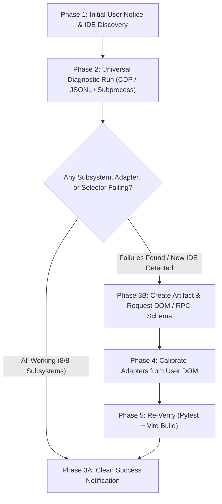

# AgentWatch V2 — Universal IDE Diagnostic, Calibration & Architecture Guide (`Update.md`)

> **Environment Calibration Baseline**:
>
> - **Target Application**: **Universal AI IDE Architecture** (Desktop AI Coding Environments: Antigravity IDE, Cursor, Windsurf, VS Code)
> - **Last Calibrated & Verified**: **2026-11-16 01:10 IST (+05:30)**
> - **CDP Port**: `9000` (DevTools Webview RPC; scans `9001-9003`, `9222`)
> - **Database / History Engine**: Direct SQLite Conversation DBs + Gemini Brain Transcripts + Git Keizu DAG
> - **Process Monitoring Engine**: SQLite Step Protobuf Decoder (`task_proto_helper.py`) + `psutil` Process Tree Discovery

When a user asks you to **"update"**, **"run an update"**, **"sync with IDE"**, **"audit endpoints"**, or reports that a UI action (model switcher, terminal execution, task killer, queue sender, or decision cards) is unresponsive in **Google Antigravity, Cursor, Windsurf, VS Code with AI extensions, or any custom Agentic IDE**, **you MUST follow this universal calibration procedure**.

---

## Universal IDE Execution Protocol (Order of Operations)

Follow these phases sequentially:



---

## Universal IDE Compatibility & Subsystem Map

AgentWatch V2 connects cleanly to **any Agentic AI Integrated IDE**:

| Subsystem                | Antigravity IDE                               | Cursor                        | Windsurf (Cascade)        | VS Code (Cline / Roo / Copilot) | Custom AI IDEs               |
| ------------------------ | --------------------------------------------- | ----------------------------- | ------------------------- | ------------------------------- | ---------------------------- |
| **Port / Protocol**      | CDP (`port 9000`)                             | CDP / DevTools (`port 9222+`) | DevTools / Internal RPC   | DevTools / VS Code API          | Standard CDP / Headless Port |
| **Agent Transcripts**    | `.system_generated/logs/transcript.jsonl`     | `.cursor/` or SQLite storage  | `.windsurf/` session logs | Extension workspace storage     | Configurable transcript path |
| **Model / Effort Tiers** | `[data-testid="model-selector-trigger"]`      | Model selector dropdown       | Cascade model switcher    | Model configuration menu        | Calibrated selector query    |
| **Decision / Approvals** | Inline `ask_question` / Modals                | Command approval bar          | Cascade permission dialog | Inline terminal approval        | Standard DOM action triggers |
| **Background Tasks**     | SQLite DB (`status IN (2, 6)`) + `psutil` PID | Bottom terminal tabs          | Cascade execution runner  | Integrated VS Code terminal     | Multi-tab interactive runner |
| **Interactive Terminal** | `IDETerminalPanel.jsx` (Subshells)            | Bottom terminal panel         | Cascade shell runner      | VS Code integrated terminal     | Subprocess terminal runner   |
| **Git DAG Graph**        | Native Keizu DAG (`GitGraphModal.jsx`)        | Git graph extension / Keizu   | Cascade git integration   | GitLens / Keizu algorithm       | Branch-scoped pagination     |
| **Past Conversations**   | SQLite `conversations/<id>.db` + summaries    | Local session index           | Cascade project history   | Local state storage             | Session index / transcripts  |
| **Session Switching**    | SPA `/c/<cid>` + CDP click dispatch           | Session link click            | Session switch command    | Webview navigation              | DOM link click / URL update  |
| **Direct File Editing**  | Atomic disk write via temp file replace       | Direct fs API                 | Cascade workspace save    | VS Code workspace edit          | Workspace atomic write       |

---

## Complete Feature Architecture Map

### 1. Dual-Tier Terminal Architecture (Separation of Concerns)

- **Tier 1: AI Agent Task Monitoring (`WorkbenchBar.jsx` / `TaskOutputModal.jsx`)**:
  - Monitors background commands dispatched by the agent across any IDE (`run_command`, background tasks).
  - Direct database querying: reads conversation SQLite database (`status IN (2, 6)`) without DOM scraping overhead.
  - Protobuf decoding (`services/monitoring/task_proto_helper.py`): extracts raw shell command, task ID, and log URI.
  - Live OS Process Binding: uses `psutil` to verify process liveness, retrieve the exact OS `pid`, and calculate process uptime (`started_at`).
  - Refresh-persistent duration timers (`useTaskExecutionTimers.js`): scales seamlessly from seconds (`MM:SSs`) to hours (`HHh MMm SSs`) and days (`Dd HHh MMm`) without resetting on page refresh.
  - Full Command & PID Display: popover reveals the human-readable summary, `$ <command>`, `PID <pid>` badge, and clean termination trigger.
  - Recursive Process Tree Termination: `kill_task_process(pid)` terminates the target and all spawned children via `SIGTERM`/`SIGKILL` (`taskkill /PID <pid> /T /F`).
- **Tier 2: User-Executable Interactive Terminal (`IDETerminalPanel.jsx` / `terminal_session_service.py`)**:
  - Independent bottom-docked terminal pane matching native IDE `workbench.parts.panel`.
  - Runs commands in isolated subshells (`powershell`, `cmd`, `bash`) via `subprocess.Popen` in active workspace root.
  - Dedicated daemon background thread stream readers with zero polling overhead.
  - Memory-safe ring buffers (`collections.deque(maxlen=2000)`) preventing disk bloat.
  - Input line auto-disables during active command runs to prevent log interleaving.
  - Toast notifications confirming execution status (`toastService.js`).

### 2. Native React Git DAG Graph & Commit Inspector (`GitGraphModal.jsx`)

- Complete Git DAG visualization based on the Git Keizu topological lane algorithm.
- Pure React + SVG implementation with zero heavy third-party graph dependencies.
- Branch-Scoped Infinite Scroll: server-side query parameter (`/api/v1/git/graph?branch=<branch>&limit=<limit>`) scopes `git log` and `git rev-list --count` to the selected branch, preventing infinite lazy-loading loops.
- Debounced IntersectionObserver sentinel ensures smooth bottom-scrolling without multi-trigger thrashing.
- Interactive Commit Inspector: slide-in drawer showing full commit metadata, changed file trees with status badges (A/M/D/R), and unified diffs.

### 3. Interactive In-Chat Decision Cards (`QuestionCard.jsx`)

- Rendered inline directly in the chat stream when any agent invokes questions or requests decisions.
- Single-choice options trigger instant answer dispatch on click.
- Multi-choice options support checkbox toggling and batch submission.
- Highlighted `(Recommended)` priority badges and custom direction inputs.
- Auto-resolves with green checkmark badges once answered, dismissing redundant screen overlay modals.

### 4. Precision Tool & Shell Command Approvals (`cdp_forward_approval.py`)

- Disambiguated button scoring: parses **Always Allow** (`always allow`, `always run`, `allow all`) separately from single **Allow** (`allow`, `run`, `accept`) and **Deny** (`deny`, `reject`, `cancel`).
- Automatically handles split-button dropdown chevrons to expose and click hidden "Always" actions.
- Allows user custom guidance on Deny/Allow, dispatching custom instructions directly to the prompt composer.

### 5. Stream & Network Error Catchers (`conversation_service.py` / `ChatTurn.jsx`)

- Captures upstream stream aborts (`stream idle timeout`, `connection closed by remote host`, `context deadline exceeded`).
- Halts infinite loading spinners immediately (`is_working = false`).
- Displays inline error cards with the Error ID and a single-click **"Copy Debug Info"** button.

### 6. Model & Effort Tier Selector (`cdp_model_actions.py`)

- Reads active model, quota state, and available models directly from the connected IDE workbench.
- Dispatches model changes and effort tiers (Low / Medium / High).

### 7. Resilient CDP Sentinel (`cdp_connection.py` / `target_finder.py`)

- Background monitor detecting IDE disconnects, port shifts, or target changes.
- Automatically attempts target discovery and re-anchoring across standard debug ports (`9000`, `9001-9003`, `9222`).
- Socket health badge rendered in Navbar (`Navbar.jsx`).

### 8. Tailscale Dynamic Port Forwarding (`controls_tailscale.py` / `useTailscalePorts.js`)

- Exposes local services securely over Tailscale VPN without public internet exposure.
- Explicit OpenAPI operation IDs (`get_tailscale_ports_status`) preventing documentation collision warnings.

### 9. Past Conversations Sync, Search & Chat Switching (`conversation_history_service.py` / `cdp_session_actions.py`)

- Reads official SQLite databases for 1:1 titles and workspace metadata.
- Full-text keyword search and cursor/offset lazy pagination (`offset`, `limit`) with infinite scroll.
- CDP session switching (`dispatch_switch_conversation`) and clean blank slate initialization (`dispatch_new_conversation`).
- Direct file editor saving (`services/workspace/file_editor_service.py`) straight to disk.

---

## Diagnostic & Calibration Workflow

### Phase 1: Notify the User That the Audit Has Started

Print a concise message in chat before starting checks:

> **Starting Universal AI IDE Calibration & Endpoint Audit...**  
> Checking DevTools/CDP connection (ports `9000`, `9001-9003`, `9222+`) and auditing interaction subsystems (Model/Quota, Effort Tiers, Queue, Running Tasks, Terminal Sessions, and Dialogs) across active IDE workspaces.

---

### Phase 2: Run the Automated Diagnostic Suite

Execute this non-destructive diagnostic runner script:

```python
import asyncio, os, sys
from integrations.antigravity.core.adapter import antigravity_adapter
from services.monitoring.task_monitor_service import task_monitor_service
from services.terminal.terminal_session_service import terminal_session_service
from services.git_graph_service import get_git_graph
from pathlib import Path


async def run_diagnostic():
    report = {"cdp": False, "detected_ide": "Universal", "subsystems": {}}
    antigravity_adapter.discover_cdp()
    chat_url = antigravity_adapter.active_chat_url
    if not chat_url:
        report["error"] = "No supported AI IDE DevTools/CDP detected on ports 9000/9222"
    else:
        report["cdp"] = True
        report["target"] = chat_url

        from integrations.antigravity.cdp.cdp_model_actions import (
            dispatch_read_model,
            dispatch_scan_available_models,
        )

        # 1. Model & Quota
        try:
            m = await dispatch_read_model(chat_url)
            report["subsystems"]["model_and_quota"] = {
                "ok": bool(m.get("model")),
                "model": m.get("model"),
                "quota": m.get("quota_status"),
            }
        except Exception as e:
            report["subsystems"]["model_and_quota"] = {"ok": False, "error": str(e)}

        # 2. Effort Tiers (Low/Medium/High)
        try:
            models = await dispatch_scan_available_models(chat_url)
            has_tiers = any("low" in (x.get("name") or "").lower() for x in models)
            report["subsystems"]["effort_tiers"] = {
                "ok": len(models) > 0 and has_tiers,
                "count": len(models),
                "models": [x.get("name") for x in models],
            }
        except Exception as e:
            report["subsystems"]["effort_tiers"] = {"ok": False, "error": str(e)}

    # 3. Running Tasks & PID Process Monitoring (Direct DB + OS psutil)
    try:
        tasks = task_monitor_service.get_active_tasks()
        report["subsystems"]["running_tasks"] = {
            "ok": True,
            "tasks_found": len(tasks),
            "sample_pids": [t.get("pid") for t in tasks if t.get("pid")],
        }
    except Exception as e:
        report["subsystems"]["running_tasks"] = {"ok": False, "error": str(e)}

    # 4. Interactive Terminal Sessions
    try:
        sessions = terminal_session_service.list_sessions()
        report["subsystems"]["terminal_sessions"] = {"ok": True, "active_tabs": len(sessions)}
    except Exception as e:
        report["subsystems"]["terminal_sessions"] = {"ok": False, "error": str(e)}

    # 5. Git DAG Graph & Branch Scoping
    try:
        graph = await get_git_graph(Path(os.getcwd()), limit=10)
        report["subsystems"]["git_graph"] = {
            "ok": bool(graph.get("has_git")),
            "branch_count": len(graph.get("branches", [])),
            "commits_count": len(graph.get("commits", [])),
        }
    except Exception as e:
        report["subsystems"]["git_graph"] = {"ok": False, "error": str(e)}

    return report


if __name__ == "__main__":
    res = asyncio.run(run_diagnostic())
    import json

    print(json.dumps(res, indent=2))
```

---

### Phase 3A: If All Subsystems Pass (Clean Success Notification)

Present this clean summary to the user:

> **AgentWatch V2 is fully synchronized with your AI Integrated IDE!**
>
> - **Connection Protocol**: DevTools / CDP Active
> - **Active Model**: `{model_name}` (Quota: `{quota_status}`)
> - **Available Tiers**: {count} models detected (including Low / Medium / High tiers)
> - **Background Tasks Engine**: Synced via SQLite + `psutil` (Live PIDs, scaled timers & tree killing active)
> - **Git DAG Graph**: Synced via Keizu branch-scoped pagination
> - **Interactive Terminal**: Ready (`IDETerminalPanel.jsx` subshells enabled)
> - **Decision Cards & Message Queue**: Synced
>
> All backend routes and UI triggers are responsive. No DOM updates needed.

---

### Phase 3B: If Failures Are Detected (Create Artifact & Prompt User)

If any subsystem encounters DOM errors, unknown selectors, or IDE layout divergence:

1. **DO NOT GUESS SELECTORS.**
2. **Create the artifact**: Write `<artifacts_directory>/dom_investigation_report.md`.
3. **Notify the user with the exact response format:**

> **IDE Build Divergence Detected**  
> Some UI elements in your AI Integrated IDE build have changed their internal classes or attributes.
>
> I have created an inspection artifact for you:  
> **`dom_investigation_report.md`**
>
> Please open DevTools (press **`Ctrl + Shift + I`** in your IDE or navigate to `http://localhost:9000` in Chrome), use the **Inspect Element cursor tool** (`Ctrl + Shift + C`) to hover over and click the failing component, right-click the highlighted node, select **Copy → Copy OuterHTML** (or **Copy selector**), and paste it here so I can calibrate the backend dispatchers immediately.

---

### Phase 4: Calibrating Selectors from User DOM

Apply updates to the corresponding module:

| Component                          | Target File                                            | What to Adjust                                                                     |
| ---------------------------------- | ------------------------------------------------------ | ---------------------------------------------------------------------------------- |
| **Model & Quota Indicator**        | `integrations/antigravity/cdp/cdp_model_actions.py`    | Outer button test ID & inner SVG color classes                                     |
| **Effort Submenu (Low/Med/High)**  | `integrations/antigravity/cdp/cdp_model_actions.py`    | Model selector effort group & radio option selectors                               |
| **Running Tasks Panel**            | `services/monitoring/task_monitor_service.py`          | SQLite status query codes (`status IN (2, 6)`), protobuf tags                      |
| **Interactive Terminal Execution** | `services/terminal/terminal_session_service.py`        | Process tree termination (`taskkill`) & shell execution args                       |
| **Queued Messages Card**           | `integrations/antigravity/cdp/cdp_queue_actions.py`    | Queued messages card, Send now, Edit, and Delete buttons                           |
| **Decision & Prompt Dispatches**   | `integrations/antigravity/cdp/cdp_question_actions.py` | Action decision buttons & confirmation triggers                                    |
| **Command & Tool Approvals**       | `integrations/antigravity/cdp/cdp_forward_approval.py` | Split-button dropdown chevrons & Allow/Always Allow rules                          |
| **Git DAG Graph Pagination**       | `services/git_graph_service.py`                        | Branch-scoped `git log` and `git rev-list --count` arguments                       |
| **Past Conversations Index**       | `services/chat/conversation_history_service.py`        | SQLite summary queries & fallback transcript parsers                               |
| **Active Session Switching**       | `integrations/antigravity/cdp/cdp_session_actions.py`  | `dispatch_switch_conversation`, `dispatch_new_conversation`, and sidebar selectors |
| **Direct File Editing**            | `services/workspace/file_editor_service.py`            | Atomic temp file write and safe path boundary restrictions                         |

---

### Phase 5: Verification & Completion Gates

Before marking any update complete:

1. **Tests Pass**: Run `.venv\Scripts\python.exe -m pytest tests/` (all tests must pass 100%).
2. **Frontend Builds**: Run `npm run build` in `frontend/` (must build cleanly).
3. **Architecture Standards**:
   - Files ≤ 500 lines (refactor threshold: 400 lines).
   - Zero gradient colors (pure solid dark-mode surfaces).
   - Lucide SVG icons only (zero emojis in UI).
