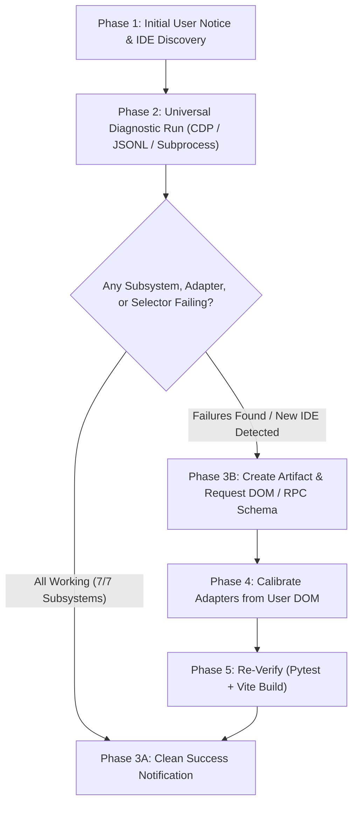

# AgentWatch V2 — Universal IDE Diagnostic, Calibration & Architecture Guide (`Update.md`)

When a user asks you to **"update"**, **"run an update"**, **"sync with IDE"**, **"audit endpoints"**, or reports that a UI action (model switcher, terminal execution, task killer, queue sender, or decision cards) is unresponsive in **Google Antigravity, Cursor, Windsurf, VS Code with AI extensions, or any custom Agentic IDE**, **you MUST follow this universal calibration procedure**.

---

## 🧭 Universal IDE Execution Protocol (Order of Operations)

Follow these phases sequentially:



---

## 🌐 Universal IDE Compatibility & Subsystem Map

AgentWatch V2 is engineered to connect to **any Agentic AI Integrated IDE**:

| Subsystem | Antigravity IDE | Cursor | Windsurf (Cascade) | VS Code (Cline / Roo / Copilot) | Custom AI IDEs |
|---|---|---|---|---|---|
| **Port / Protocol** | CDP (`port 9000`) | CDP / DevTools (`port 9222+`) | DevTools / Internal RPC | DevTools / VS Code API | Standard CDP / Headless Port |
| **Agent Transcripts** | `.system_generated/logs/transcript.jsonl` | `.cursor/` or SQLite storage | `.windsurf/` session logs | Extension workspace storage | Configurable transcript path |
| **Model / Effort Tiers** | `[data-testid="model-selector"]` | Model selector dropdown | Cascade model switcher | Model configuration menu | Calibrated selector query |
| **Decision / Approvals** | Inline `ask_question` / Modals | Command approval bar | Cascade permission dialog | Inline terminal approval | Standard DOM action triggers |
| **Terminal & Tasks** | `[data-testid="running-items-panel"]` | Bottom terminal tabs | Cascade execution runner | Integrated VS Code terminal | Multi-tab interactive runner |

---

## 🛠️ Complete Feature Architecture Map

### 1. Two-Tier Terminal Architecture (Separation of Concerns)
- **Tier 1: AI Agent Task Monitoring (`WorkbenchBar.jsx` / `TaskOutputModal.jsx`)**:
  - Monitors background commands dispatched by the agent across any IDE (`run_command`, background tasks).
  - Tracks client-side duration timers (`useTaskExecutionTimers.js`) with zero server overhead.
  - Allows stdout/stderr peeking into `.system_generated/tasks/task-*.log` or equivalent task logs.
  - Dispatches termination requests to the running agent via IDE adapter.
- **Tier 2: User-Executable Interactive Terminal (`AntigravityTerminalPanel.jsx` / `TerminalSessionService.py`)**:
  - Independent bottom-docked terminal pane matching native IDE `workbench.parts.panel`.
  - Runs commands in isolated subshells (`powershell`, `cmd`, `bash`) via `subprocess.Popen` in workspace root.
  - Dedicated daemon background thread stream readers with zero polling overhead.
  - Memory-safe ring buffers (`collections.deque(maxlen=2000)`) preventing disk bloat.
  - Input line auto-disables during active command runs to prevent log interleaving.
  - Process tree kill via `taskkill /PID <pid> /T /F` (Windows) or `pkill` (POSIX) terminating all child processes.
  - Toast notifications confirming execution status (`toastService.js`).

### 2. Interactive In-Chat Decision Cards (`QuestionCard.jsx`)
- Rendered inline directly in the chat stream when any agent invokes questions or requests decisions.
- Single-choice options trigger instant answer dispatch on click.
- Multi-choice options support checkbox toggling and batch submission.
- Highlighted `(Recommended)` priority badges and custom direction inputs.
- Auto-resolves with green checkmark badges once answered, dismissing redundant screen overlay modals.

### 3. Stream & Network Error Catchers (`conversation_service.py` / `ChatTurn.jsx`)
- Captures upstream stream aborts (`stream idle timeout`, `connection closed by remote host`, `context deadline exceeded`).
- Halts infinite loading spinners immediately (`is_working = false`).
- Displays inline error cards with the Error ID and a single-click **"Copy Debug Info"** button.

### 4. Model & Effort Tier Selector (`cdp_model_actions.py`)
- Reads active model, quota state, and available models directly from the connected IDE workbench.
- Dispatches model changes and effort tiers (Low / Medium / High).

### 5. Resilient CDP Sentinel (`cdp_connection_sentinel.py`)
- Background monitor detecting IDE disconnects, port shifts, or target changes.
- Automatically attempts target discovery and re-anchoring across standard debug ports (`9000`, `9222`).
- Socket health badge rendered in Navbar (`Navbar.jsx`).

### 6. Tailscale Dynamic Port Forwarding (`controls_tailscale.py` / `useTailscalePorts.js`)
- Exposes local services securely over Tailscale VPN without public internet exposure.

---

## 🧭 Diagnostic & Calibration Workflow

### Phase 1: Notify the User That the Audit Has Started

Print a concise message in chat before starting checks:

> 🔍 **Starting Universal AI IDE Calibration & Endpoint Audit...**  
> Checking DevTools/CDP connection (ports `9000`, `9222+`) and auditing interaction subsystems (Model/Quota, Effort Tiers, Queue, Running Tasks, Terminal Sessions, and Dialogs) across active IDE workspaces.

---

### Phase 2: Run the Automated Diagnostic Suite

Execute this non-destructive diagnostic runner script:

```python
import asyncio, os, sys
from integrations.antigravity.adapter import antigravity_adapter

async def run_diagnostic():
    report = {"cdp": False, "detected_ide": "Universal", "subsystems": {}}
    antigravity_adapter.discover_cdp()
    chat_url = antigravity_adapter.active_chat_url
    if not chat_url:
        report["error"] = "No supported AI IDE DevTools/CDP detected on ports 9000/9222"
        return report
    
    report["cdp"] = True
    report["target"] = chat_url

    from integrations.antigravity.cdp_actions import (
        dispatch_read_model,
        dispatch_scan_available_models,
        dispatch_get_terminal_tasks
    )
    from services.terminal_session_service import terminal_session_service

    # 1. Model & Quota
    m = await dispatch_read_model(chat_url)
    report["subsystems"]["model_and_quota"] = {
        "ok": bool(m.get("model")),
        "model": m.get("model"),
        "quota": m.get("quota_status")
    }

    # 2. Effort Tiers (Low/Medium/High)
    models = await dispatch_scan_available_models(chat_url)
    has_tiers = any("low" in (x.get("name") or "").lower() for x in models)
    report["subsystems"]["effort_tiers"] = {
        "ok": len(models) > 0 and has_tiers,
        "count": len(models),
        "models": [x.get("name") for x in models]
    }

    # 3. Running Tasks Panel
    tasks = await dispatch_get_terminal_tasks(chat_url)
    report["subsystems"]["running_tasks"] = {
        "ok": tasks.get("success", False),
        "tasks_found": len(tasks.get("tasks", []))
    }

    # 4. Interactive Terminal Sessions
    sessions = terminal_session_service.list_sessions()
    report["subsystems"]["terminal_sessions"] = {
        "ok": True,
        "active_tabs": len(sessions)
    }

    return report

asyncio.run(run_diagnostic())
```

---

### Phase 3A: If All Subsystems Pass (Clean Success Notification)

Present this clean summary to the user:

> ✅ **AgentWatch V2 is fully synchronized with your AI Integrated IDE!**
> 
> - **Connection Protocol**: DevTools / CDP Active
> - **Active Model**: `{model_name}` (Quota: `{quota_status}`)
> - **Available Tiers**: {count} models detected (including Low / Medium / High tiers)
> - **Running Tasks / Background Execution**: Synced
> - **Interactive Terminal**: Ready (Powershell / Bash sessions enabled)
> - **Decision Cards & Message Queue**: Synced
> 
> All backend routes and UI triggers are responsive. No DOM updates needed.

---

### Phase 3B: If Failures Are Detected (Create Artifact & Prompt User)

If any subsystem encounters DOM errors, unknown selectors, or IDE layout divergence:

1. **DO NOT GUESS SELECTORS.**
2. **Create the artifact**: Write `<artifacts_directory>/dom_investigation_report.md`.
3. **Notify the user with the exact response format:**

> ⚠️ **IDE Build Divergence Detected**  
> Some UI elements in your AI Integrated IDE build have changed their internal classes or attributes.  
> 
> I have created an inspection artifact for you:  
> 📄 **`dom_investigation_report.md`**  
> 
> Please press **`Ctrl + Shift + I`** in your IDE, right-click the failing component, select **Copy → Copy OuterHTML**, and paste it here so I can calibrate the backend dispatchers immediately.

---

### Phase 4: Calibrating Selectors from User DOM

Apply updates to the corresponding module:

| Component | Target File | What to Adjust |
|---|---|---|
| **Model & Quota Indicator** | `integrations/antigravity/cdp_model_actions.py` | Outer button test ID & inner SVG color classes |
| **Effort Submenu (Low/Med/High)**| `integrations/antigravity/cdp_model_actions.py` | Model selector effort group & radio option selectors |
| **Running Tasks Panel** | `integrations/antigravity/cdp_terminal_actions.py` | Running items panel, toggle button, & Stop Task selector |
| **Interactive Terminal Execution** | `services/terminal_session_service.py` | Process tree termination (`taskkill`) & shell execution args |
| **Queued Messages Card** | `integrations/antigravity/cdp_queue_actions.py` | Queued messages card, Send now, Edit, and Delete buttons |
| **Decision & Prompt Dispatches**| `integrations/antigravity/cdp_question_actions.py` | Action decision buttons & confirmation triggers |

---

### Phase 5: Verification & Completion Gates

Before marking any update complete:

1. **Tests Pass**: Run `.venv\Scripts\python.exe -m pytest tests/` (all tests must pass 100%).
2. **Frontend Builds**: Run `npm run build` in `frontend/` (must build cleanly).
3. **Architecture Standards**:
   - Files ≤ 500 lines (refactor threshold: 400 lines).
   - Zero gradient colors (pure solid dark-mode surfaces).
   - Lucide SVG icons only (zero emojis in UI).
